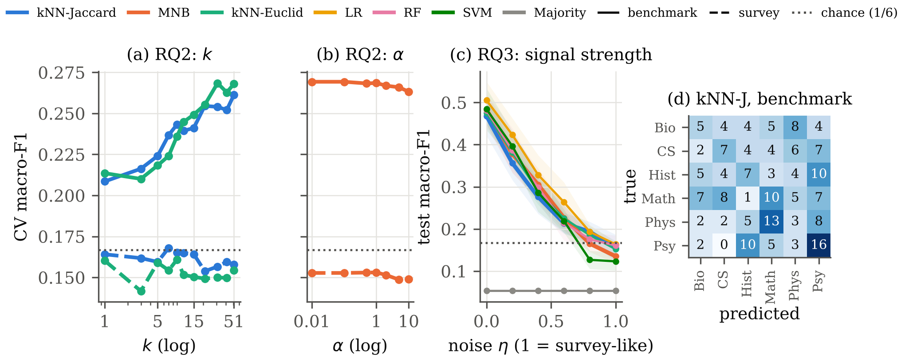

# MajorMatch: From Hobbies to Major

**CSC503 × SENG474: Data Mining, University of Victoria, Fall 2026 (Team 3R)**
Thai Hung Vuong · Brendan Wong · Robert Legassicke · Yashwanthkrishna Nagharaj

## 1. Overview

Choosing a university major is hard because students rarely know how their skills and extracurricular activities relate to each field. **MajorMatch** recommends the top-*n* majors for a student, given which skills they have and which clubs they belong to. Each recommendation comes with a percentage match *p(u,m)*.

Each student is a binary vector over 12 features (6 skills + 6 clubs). Two recommenders are proposed (Milestone 3) and evaluated against five baselines (Milestone 4):

| Role | Model | Implementation |
|---|---|---|
| **Proposed** | k-NN with Jaccard distance (votes, ties broken by the nearest neighbour) | `src/majormatch/knn.py` |
| **Proposed** | Multinomial Naive Bayes with Laplace smoothing | `src/majormatch/mnb.py` |
| Baseline | k-NN with Euclidean distance | scikit-learn |
| Baseline | Logistic Regression (multinomial, L2) | scikit-learn |
| Baseline | Random Forest | scikit-learn |
| Baseline | RBF SVM (Platt-scaled probabilities) | scikit-learn |
| Baseline | Majority / prior (sanity floor) | scikit-learn |



## 2. Illustrative sample

```
$ python -m src.main --query Programming "Data Analysis" "Coding Club" --dataset benchmark
[benchmark] kNN-Jaccard (k=7): [...] -> Physics (43%), Mathematics (29%)
[benchmark] MNB (alpha=1.0): [...] -> Computer Science (23%), Mathematics (23%)
```

Input: the student's selected features. Output: the top-2 majors, best first, each with its match value. Valid features: `Artistic, Data Analysis, Leadership, Problem Solving, Programming, Public Speaking, Art Club, Coding Club, Debate Club, Music Club, Sports Team, Volunteer Group`.

## 3. Prerequisites

* Python ≥ 3.10 (tested on 3.13)
* `numpy`, `pandas`, `scikit-learn`, `matplotlib` (see `requirements.txt`)
* No GPU. The full evaluation takes about 10 minutes on a laptop CPU (`--quick`: about 2 minutes).

## 4. Installation

```bash
git clone https://github.com/yashwanth973/CSC503.git
cd CSC503
python -m venv .venv
source .venv/bin/activate          # Windows: .venv\Scripts\activate
pip install -r requirements.txt
```

Or with conda: `conda env create -f environment.yml && conda activate majormatch`.

Both datasets are included, so there is nothing to download.

## 5. Quick start

```bash
bash quickstart.sh            # macOS / Linux
quickstart.bat                # Windows
```

The quick-start script installs the requirements, runs the unit and reproducibility tests and a sample recommendation, and then reruns the full evaluation that produced every number and figure in the report.

Individual commands:

```bash
python -m src.experiments                 # full Milestone 4 study (5 seeds)
python -m src.experiments --quick         # 1 seed, fast check
python -m src.experiments --figures-only  # redraw figures from saved CSVs
python -m src.main --query Leadership "Debate Club" --model mnb --top-n 3
python -m unittest discover tests
```

## 6. Evaluation (Milestone 4)

### Datasets

| | Survey (real) | Benchmark (controlled) |
|---|---|---|
| Source | team survey, `data/raw/student_data_extended.csv` | generated by `src/cmn/data.py::make_synthetic` |
| Students / features / majors | 1000 / 12 / 6 | 1000 / 12 / 6 |
| Class share (min–max) | 14.9–17.9% | 14.9–19.3% |
| Avg. features per student | 7.07 | 6.50 |
| Missing values | 0 | 0 |

The **benchmark** draws each student's major with the survey's class proportions. Each feature is then drawn with probability `(1-η)·profile[major] + η·prevalence[feature]`, where the major profiles are listed in `src/cmn/config.py` and prevalence is the feature's rate in the survey. At η = 1 it reproduces the survey's distribution exactly. The main benchmark uses **η = 0.5, fixed before any results were seen**. RQ3 sweeps η from 0 to 1.

### Protocol (identical for every model)

1. Stratified **80% development / 20% final test** split.
2. **Stratified 5-fold CV** on the development set, with the **same folds for all models**, and a grid search over each model's hyperparameters (`src/baselines/models.py`). The best configuration is the one with the highest mean CV **macro-F1**.
3. The best configuration is refit on the whole development set and evaluated **once** on the final test set.
4. Steps 1–3 are repeated for seeds 2026–2030. Results are reported as mean ± std.

Metrics: macro precision, recall and F1 (primary), top-1 and top-2 accuracy, macro one-vs-rest AUC, confusion matrix, and fit+predict time.

### RQ1: final-test results (mean over 5 seeds)

| Model | Survey macro-F1 | Survey top-2 | Benchmark macro-F1 | Benchmark top-2 | Benchmark AUC |
|---|---|---|---|---|---|
| **kNN-Jaccard** (ours) | 0.171 ± 0.020 | 0.303 | 0.244 ± 0.034 | 0.471 | 0.612 |
| **MNB** (ours) | 0.138 ± 0.017 | 0.329 | 0.265 ± 0.036 | 0.522 | 0.670 |
| kNN-Euclid | 0.164 ± 0.017 | 0.358 | 0.275 ± 0.039 | 0.493 | 0.636 |
| LR | 0.173 ± 0.028 | 0.337 | **0.297 ± 0.035** | **0.541** | **0.674** |
| RF | 0.155 ± 0.023 | 0.349 | 0.271 ± 0.033 | 0.496 | 0.654 |
| SVM | 0.159 ± 0.030 | 0.375 | 0.262 ± 0.033 | 0.520 | 0.648 |
| Majority | 0.051 | 0.355 | 0.053 | 0.368 | 0.500 |

Random guessing gives macro-F1 ≈ 0.167 and top-2 accuracy ≈ 0.333. On the survey, every model is at chance: the survey's features carry no information about the major (χ² p > 0.19 for all 12 features). On the benchmark, every model learns, and Logistic Regression is best. See the report for the full discussion.

All raw and summary results are in `Evaluation/results/`:
- `rq1_test_summary.csv`, `rq3_eta_sweep.csv`, `cv_results_all_runs.csv`, `test_results_all_runs.csv`, `best_configs.csv`, `confusion_*.csv`, `dataset_statistics.json`
- figures in `Evaluation/results/figures/`

The exact splits are in `data/preprocessed/` and `Evaluation/ground_truth/`.

### Reproducibility

All randomness is seeded: the splits, folds, benchmark generation and every model use the run's seed. Ties are broken deterministically (stable sort for distances, major name for scores). Re-running `python -m src.experiments` therefore reproduces every metric exactly. Only the timing column depends on the machine. `tests/` checks that the split, the benchmark and the models are deterministic.

## Repository structure

```
├── data/raw/                 # survey export
├── data/preprocessed/        # dev/test partitions written by the experiments
├── src/
│   ├── cmn/                  # common layer: config, data + benchmark, seeding, metrics, plots
│   ├── majormatch/           # proposed methods: knn.py, mnb.py, model_selection.py (CV)
│   ├── baselines/            # scikit-learn baselines behind the same interface
│   ├── experiments.py        # Milestone 4 driver (RQ1-RQ3)
│   └── main.py               # recommendation CLI
├── tests/                    # unit + reproducibility tests
├── Evaluation/               # Milestone 4 report (LaTeX + PDF) + ground_truth/ and results/ of the experiments
├── Background/  Project Proposal/
├── quickstart.sh / quickstart.bat
├── requirements.txt / environment.yml
└── LICENSE
```

## 7. Citation

```bibtex
@misc{majormatch2026,
  title  = {MajorMatch: From Hobbies to Major},
  author = {Vuong, Thai Hung and Wong, Brendan and Legassicke, Robert and Nagharaj, Yashwanthkrishna},
  year   = {2026},
  note   = {CSC503 course project, University of Victoria},
  url    = {https://github.com/yashwanth973/CSC503}
}
```

## 8. License

Released under the MIT License (see `LICENSE`).
